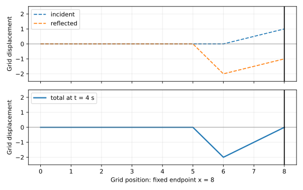
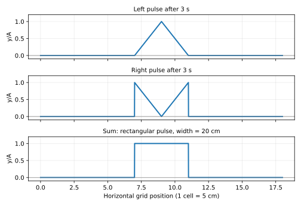

# เฉลยพร้อมวิธีทำ — ทบทวนสอบปลายภาค ฟิสิกส์วิศวกรรม อ.แยมโร

วันที่ 4 พฤศจิกายน 2026 • โจทย์หลัก 70 ข้อ + ตัวอย่าง Ex หน้า 2

ต้นฉบับ: ทบทวนสอบปลายภาค ฟิสิกส์วิศวกรรม อ.แยมโร (1).pdf

**อ้างเลขหน้า PDF 58 หน้าตามตัวแสดงไฟล์ ไม่ใช่ตัวอ่านข้อความที่อ่านได้ 56 หน้า**

เฉลยนี้จัดทำใหม่ ไม่ใช่เฉลยทางการของผู้สอน และไม่ใช้คำตอบโจทย์ดัดแปลงบนเว็บมาแทนต้นฉบับ

ข้อที่ต้องอ่านหมายเหตุ: คลื่น 6 (ธรรมเนียมเฟส), แสงเชิงคลื่น 7 (ไม่ระบุลำดับมืด), เสียง 18 (ข้อความตารางไม่สมบูรณ์)

## ตารางคำตอบ — คลื่น

| ข้อ | หน้า PDF | ตัวเลือก | คำตอบ |
| --- | --- | --- | --- |
| 1 | 7 | ตัวเลือก 1 | อนุภาคสั่นขนานกับทิศการเคลื่อนที่ของคลื่น |
| 2 | 7 | ตัวเลือก 2 | 2.5 Hz |
| 3 | 7 | ตัวเลือก 2 | 1.5 cm/s |
| 4 | 8 | ตัวเลือก 2 | 4 m |
| 5 | 8 | ตัวเลือก 2 | 40 ms |
| 6 | 8 | ตัวเลือก 3 * | A = 5 cm, T = 8 s, f = 0.125 Hz, เฟสเริ่มต้น 90° ในรูปไซน์ |
| 7 | 9 | ตัวเลือก 4 | 180° เมื่อเทียบภายในหนึ่งรอบ |
| 8 | 9 | ตัวเลือก 5 | ภาพ ข และ ค |
| 9 | 10 | ตัวเลือก 3 | คลื่นสะท้อนกลับหัว แต่คลื่นส่งผ่านไม่กลับหัว |
| 10 | 11 | ตัวเลือก 4 | รูปตัวเลือก 4 |
| 11 | 12 | ตัวเลือก 1 | ข้อความ ก และ ข ถูก |
| 12 | 12 | ตัวเลือก 3 | 4√2 m/s ≈ 5.657 m/s |
| 13 | 12 | ตัวเลือก 1 | ประมาณ 0.50 m/s |
| 14 | 13 | ตัวเลือก 2 | 1.0 m/s |
| 15 | 13 | ตัวเลือก 3 | 45 m/s |
| 16 | 14 | ตัวเลือก 3 | 90 cm |
| 17 | 14 | ตัวเลือก 1 | ปฏิบัพลำดับที่ 1 |
| 18 | 14 | ตัวเลือก 2 | 5 Hz |
| 19 | 58 | ตัวเลือก 2 | ปฏิบัพ 5 แนว และบัพ 4 แนว |
| 20 | 58 | ตัวเลือก 2 | ข้อความ ง ผิด |

## ตารางคำตอบ — แสงเชิงคลื่น

| ข้อ | หน้า PDF | ตัวเลือก | คำตอบ |
| --- | --- | --- | --- |
| 1 | 17 | ตัวเลือก 3 | 500 nm |
| 2 | 17 | ตัวเลือก 2 | 0.26 mm |
| 3 | 18 | ตัวเลือก 3 | 1.5 m |
| 4 | 18 | ตัวเลือก 2 | ประมาณ 3.33 μm ตามการประมาณมุมเล็ก |
| 5 | 19 | ตัวเลือก 4 | ข้อความ ก และ ค ถูก |
| 6 | 20 | ตัวเลือก 3 | 7 แถบ |
| 7 | 20 | ตัวเลือก 4 * | 2λ หากเป็นแถบมืดลำดับแรก |
| 8 | 21 | ตัวเลือก 4 | 12.6 mm |
| 9 | 21 | ตัวเลือก 1 | 0.06328 mm ≈ 0.063 mm |
| 10 | 22 | ตัวเลือก 1 | 1.0 × 10⁻⁴ m |

## ตารางคำตอบ — แสงเชิงรังสี

| ข้อ | หน้า PDF | ตัวเลือก | คำตอบ |
| --- | --- | --- | --- |
| 1 | 29 | ตัวเลือก 4 | 60° |
| 2 | 29 | ตัวเลือก 2 | 130 cm จากพื้น |
| 3 | 30 | ตัวเลือก 2 | 3.5 m |
| 4 | 30 | ตัวเลือก 3 | 2θ |
| 5 | 31 | ตัวเลือก 4 | 9.0 m/s |
| 6 | 31 | ตัวเลือก 1 | ความถี่เท่าเดิม แต่ความยาวคลื่นลดลง |
| 7 | 32 | ตัวเลือก 2 | √2 ≈ 1.4 เท่า |
| 8 | 32 | ตัวเลือก 3 | √3 ≈ 1.7 |
| 9 | 33 | ตัวเลือก 2 | 1.5 × 10⁸ m/s และมุมหักเหมากกว่า 20° |
| 10 | 34 | ตัวเลือก 1 | R/μ ใต้จุด P |
| 11 | 34 | ตัวเลือก 3 | 30 cm ใต้ผิวน้ำ |
| 12 | 35 | ตัวเลือก 4 | เลนส์ห่างวัตถุ 60 cm |
| 13 | 35 | ตัวเลือก 5 | 9/15 cm = 0.60 cm |
| 14 | 36 | ตัวเลือก 4 | เลนส์เว้า ความยาวโฟกัสมีขนาด 20 cm (f = −20 cm) |
| 15 | 36 | ตัวเลือก 1 | 0.25 cm |
| 16 | 36 | ตัวเลือก 2 | เสมือน หัวตั้ง อยู่หลังกระจก 9 cm สูง 0.60 cm |
| 17 | 37 | ตัวเลือก 4 | aL/(a − b) |
| 18 | 37 | ตัวเลือก 4 | ข้อ 4 ไม่ถูกต้อง: ภาพห่างเลนส์นูน 16 cm ไม่ใช่ 4 cm |
| 19 | 38 | ตัวเลือก 4 | สีเหลือง ในบรรดาตัวเลือกที่ให้ |
| 20 | 38 | ตัวเลือก 1 | หมวกเขียว เสื้อเขียว ลายมังกรดำ |

## ตารางคำตอบ — เสียง

| ข้อ | หน้า PDF | ตัวเลือก | คำตอบ |
| --- | --- | --- | --- |
| 1 | 50 | ตัวเลือก 1 | ความถี่ และรูปร่างคลื่น |
| 2 | 50 | ตัวเลือก 4 | 680 Hz |
| 3 | 50 | ตัวเลือก 3 | ประมาณ 800 m (คำนวณได้ 801.16 m) |
| 4 | 51 | ตัวเลือก 4 | 60° และมากกว่า 60° ตามแบบจำลองรังสีของโจทย์ |
| 5 | 51 | ตัวเลือก 4 | 1075 Hz สำหรับความถี่ต่ำสุดที่ตรงตัวเลือก |
| 6 | 51 | ตัวเลือก 2 | ประมาณ 7 m (คำนวณได้ 7.071 m) |
| 7 | 52 | ตัวเลือก 2 | ประมาณ 95 dB (94.77 dB) |
| 8 | 52 | ตัวเลือก 3 | 150 m |
| 9 | 53 | ตัวเลือก 2 | 4π × 10⁻⁵ W ≈ 1.2566 × 10⁻⁴ W |
| 10 | 53 | ตัวเลือก 3 | 344 m/s |
| 11 | 53 | ตัวเลือก 3 | 500 Hz |
| 12 | 54 | ตัวเลือก 2 | 2 เท่า |
| 13 | 54 | ตัวเลือก 4 | ประมาณ 509 Hz ตามตัวเลือก |
| 14 | 54 | ตัวเลือก 1 | v/(2L) |
| 15 | 55 | ตัวเลือก 3 | ส้อม C และ 10 ครั้ง |
| 16 | 55 | ตัวเลือก 2 | 1.01/0.99 = 101/99 ≈ 1.0202 |
| 17 | 55 | ตัวเลือก 4 | 1715 Hz |
| 18 | 56 | ตัวเลือก 5 * | ข้อ 5 น่าจะเป็นเจตนา หากช่อง ค หมายถึงเคลื่อนที่ด้วยความเร็วเท่ากัน |
| 19 | 57 | ตัวเลือก 3 | 690 m/s |
| 20 | 57 | ตัวเลือก 4 | 9.0 km |

## คลื่น — วิธีทำ

### ข้อ 1 — นิยามคลื่นตามยาว (PDF หน้า 7)

**ตัวเลือก 1 — อนุภาคสั่นขนานกับทิศการเคลื่อนที่ของคลื่น**

พิจารณาทิศการสั่นของอนุภาค ไม่ใช่รูปทรงหรือความยาวของตัวกลาง

คลื่นตามยาวมีบริเวณอัด–ขยาย อนุภาคสั่นกลับไปกลับมาตามแนวการแพร่ของคลื่น จึงตรงกับตัวเลือก 1

### ข้อ 2 — ความถี่จากระยะสันที่ 1 ถึงสันที่ 4 (PDF หน้า 7)

**ตัวเลือก 2 — 2.5 Hz**

สันที่ 1 ถึงสันที่ 4 มี 3 ช่วงความยาวคลื่น ไม่ใช่ 4 ช่วง

$$
\lambda=\frac{7.2}{4-1}=2.4\;\mathrm m
$$

$$
f=\frac{v}{\lambda}=\frac{6.0}{2.4}=2.5\;\mathrm{Hz}
$$

### ข้อ 3 — อ่านกราฟตำแหน่งและกราฟเวลา (PDF หน้า 7)

**ตัวเลือก 2 — 1.5 cm/s**

กราฟซ้าย ยอดติดกันอยู่ประมาณ x = 2 และ 14 cm จึงได้ความยาวคลื่น 12 cm; กราฟขวา ยอดอยู่ที่ t = 10, 18, 26 s จึงได้คาบ 8 s

$$
\lambda=14-2=12\;\mathrm{cm},\qquad T=18-10=8\;\mathrm s
$$

$$
v=\frac{\lambda}{T}=\frac{12}{8}=1.5\;\mathrm{cm/s}
$$

### ข้อ 4 — คาบหน่วยมิลลิวินาที (PDF หน้า 8)

**ตัวเลือก 2 — 4 m**

อ่านจากยอดติดกันในกราฟได้คาบ 2 ms และโจทย์ให้อัตราเร็ว 2 × 10³ m/s

$$
T=2\times10^{-3}\;\mathrm s
$$

$$
\lambda=vT=(2\times10^3)(2\times10^{-3})=4\;\mathrm m
$$

### ข้อ 5 — เวลาจากสันคลื่นถึงสมดุลครั้งแรก (PDF หน้า 8)

**ตัวเลือก 2 — 40 ms**

การสั่นจากตำแหน่งสูงสุดถึงสมดุลครั้งแรกใช้หนึ่งในสี่คาบ

$$
T=\frac{\lambda}{v}=\frac{0.8}{5}=0.16\;\mathrm s
$$

$$
t=\frac{T}{4}=0.04\;\mathrm s=40\;\mathrm{ms}
$$

### ข้อ 6 — แอมพลิจูด คาบ และเฟสเริ่มต้น (PDF หน้า 8)

**ตัวเลือก 3 * — A = 5 cm, T = 8 s, f = 0.125 Hz, เฟสเริ่มต้น 90° ในรูปไซน์**

กราฟเริ่มที่การกระจัดสูงสุด +5 cm และกลับมาสูงสุดอีกครั้งที่ 8 s

$$
A=5\;\mathrm{cm},\qquad T=8\;\mathrm s,\qquad f=\frac18=0.125\;\mathrm{Hz}
$$

$$
y=A\sin(\omega t+\phi_0),\qquad y(0)=A\ \Rightarrow\ \phi_0=90^\circ\pmod{360^\circ}
$$

จึงเลือกข้อ 3 เมื่อใช้ธรรมเนียมเขียนการสั่นด้วยฟังก์ชันไซน์

> หมายเหตุ: โจทย์ไม่ระบุรูปสมการของเฟส หากใช้ y = A cos(ωt + φ₀) จะได้ φ₀ = 0° ซึ่งตรงตัวเลือก 2 แต่เป็นการสั่นเดียวกัน ต้องระบุธรรมเนียมไซน์ก่อนเลือกข้อ 3 ไม่ใช่สรุปว่าค่าเฟสขึ้นกับกราฟอย่างเดียว

### ข้อ 7 — ผลต่างเฟสระหว่างระยะ 30 และ 48 cm (PDF หน้า 9)

**ตัวเลือก 4 — 180° เมื่อเทียบภายในหนึ่งรอบ**

$$
\lambda=\frac{v}{f}=\frac{20}{5}=4\;\mathrm{cm},\qquad \Delta x=48-30=18\;\mathrm{cm}
$$

$$
\Delta\phi=360^\circ\frac{18}{4}=1620^\circ=4(360^\circ)+180^\circ
$$

ผลต่างเฟสที่เทียบภายในหนึ่งรอบจึงเป็น 180°; ค่าเฟสสะสมยังเป็น 1620°

### ข้อ 8 — เลื่อนคลื่นดล 4 วินาทีแล้วตรวจการหักล้าง (PDF หน้า 9)

**ตัวเลือก 5 — ภาพ ข และ ค**

$$
\Delta x=vt=(1)(4)=4\;\mathrm m
$$

เลื่อนคลื่นฝั่งซ้ายไปขวา 4 m และคลื่นฝั่งขวาไปซ้าย 4 m ก่อนบวกการกระจัดที่ตำแหน่งเดียวกัน

ภาพ ก: ส่วนที่ทับกันอยู่ใต้เส้นสมดุลทั้งคู่ จึงเสริมกัน ไม่ใช่หักล้าง

ภาพ ข: สันด้านขวาไปทับส่วนท้องของคลื่นซ้ายบริเวณ x = 5–6 m จึงเกิดการหักล้างในช่วงนั้น

ภาพ ค: ส่วนบวกกับส่วนลบซ้อนกันในช่วง x = 4–6 m จึงหักล้างบางส่วน แอมพลิจูดของคลื่นขวาเล็กกว่าคลื่นซ้าย จึงไม่จำเป็นต้องมีผลรวมเป็นศูนย์ทั้งช่วง; คำตอบคือ ข และ ค

### ข้อ 9 — คลื่นดลจากเชือกเบาไปเชือกหนัก (PDF หน้า 10)

**ตัวเลือก 3 — คลื่นสะท้อนกลับหัว แต่คลื่นส่งผ่านไม่กลับหัว**

สำหรับเชือกต่อกันและแรงตึงเท่ากัน เชือกหนักมีความหนาแน่นเชิงเส้นและอิมพีแดนซ์สูงกว่า

$$
v=\sqrt{\frac{F}{\mu}}
$$

คลื่นที่สะท้อนในเชือกเบาจึงกลับหัวและเดินทางกลับ ส่วนที่ส่งผ่านในเชือกหนักยังเป็นสันและเดินทางต่อไปทางขวา ตรงรูปตัวเลือก 3

### ข้อ 10 — คลื่นสะท้อนปลายตรึงหลัง 4 s (PDF หน้า 11)

**ตัวเลือก 4 — รูปตัวเลือก 4**

กำหนดเส้นกริดซ้ายสุดเป็น x = 0 ปลายตรึงอยู่ x = 8 ช่อง; รูปเริ่มต้นมีฐาน x = 2–7 และยอดที่ x = 6 สูง 2 ช่อง

คลื่นเคลื่อนขวา 4 ช่อง แต่ยังซ้อนกับส่วนที่สะท้อนอยู่ จึงห้ามวาดเป็นคลื่นกลับหัวทั้งลูกโดยไม่บวกส่วนตกกระทบ

$$
y(x,4)=F(x-4)-F(12-x),\qquad 0\le x\le8
$$

ผลรวมเริ่มลดจากศูนย์ที่ x = 5 เป็น −2 ช่องที่ x = 6 แล้วเพิ่มกลับถึงศูนย์ที่ปลายตรึง x = 8 จึงตรงตัวเลือก 4

> หมายเหตุ: F(x) คือรูปคลื่นเริ่มต้นตามกริด; เครื่องหมายลบหน้าคลื่นสะท้อนมาจากเงื่อนไขปลายตรึง

### ข้อ 11 — คลื่นน้ำลึกเข้าสู่น้ำตื้น (PDF หน้า 12)

**ตัวเลือก 1 — ข้อความ ก และ ข ถูก**

ในแบบจำลองคลื่นน้ำของบทเรียน อัตราเร็วลดลงเมื่อน้ำตื้นลง แต่ความถี่จากแหล่งเดิมยังคงเดิม

$$
\lambda=\frac{v}{f}
$$

ดังนั้นความยาวคลื่นเปลี่ยนและอัตราเร็วเปลี่ยน ส่วนความถี่ไม่เปลี่ยน จึงเลือก ก และ ข

### ข้อ 12 — กฎหักเหของคลื่น (PDF หน้า 12)

**ตัวเลือก 3 — 4√2 m/s ≈ 5.657 m/s**

มุมทั้งสองวัดจากแนวฉากตามนิยามมุมตกกระทบและมุมหักเห

$$
\frac{\sin\theta_1}{\sin\theta_2}=\frac{v_1}{v_2}
$$

$$
v_2=4\frac{\sin45^\circ}{\sin30^\circ}=4\sqrt2\;\mathrm{m/s}
$$

### ข้อ 13 — คลื่นน้ำจากน้ำตื้นสู่น้ำลึกและรอบต่อนาที (PDF หน้า 12)

**ตัวเลือก 1 — ประมาณ 0.50 m/s**

$$
f=\frac{3000}{60}=50\;\mathrm{Hz},\qquad \lambda_1=0.625\;\mathrm{cm}=0.00625\;\mathrm m
$$

$$
v_1=f\lambda_1=50(0.00625)=0.3125\;\mathrm{m/s}
$$

$$
v_2=v_1\frac{\sin53^\circ}{\sin30^\circ}\approx0.3125\frac{0.8}{0.5}=0.50\;\mathrm{m/s}
$$

> หมายเหตุ: ต้องแปลง 3000 รอบต่อนาทีเป็น 50 Hz; หากอ่านเป็น 3000 Hz จะได้คำตอบผิดไป 60 เท่า

### ข้อ 14 — แยกมุมหน้าคลื่นกับมุมรังสี (PDF หน้า 13)

**ตัวเลือก 2 — 1.0 m/s**

มุมหน้าคลื่นตกกระทบกับผิวเป็น 45° จึงเท่ากับมุมรังสีตกกระทบกับแนวฉาก ส่วนรังสีหักเหทำมุม 60° กับผิว จึงทำมุม 30° กับแนวฉาก

$$
\theta_1=45^\circ,\qquad\theta_2=90^\circ-60^\circ=30^\circ
$$

$$
v_2=\sqrt2\frac{\sin30^\circ}{\sin45^\circ}=1\;\mathrm{m/s}
$$

### ข้อ 15 — คลื่นนิ่ง 4 พูในเชือกยาว 1.80 m (PDF หน้า 13)

**ตัวเลือก 3 — 45 m/s**

หนึ่งพูของคลื่นนิ่งยาวครึ่งความยาวคลื่น

$$
L=4\frac{\lambda}{2}\ \Rightarrow\ \lambda=\frac{2(1.80)}4=0.90\;\mathrm m
$$

$$
v=f\lambda=50(0.90)=45\;\mathrm{m/s}
$$

### ข้อ 16 — จากปฏิบัพที่ 4 ไปบัพที่ 5 (PDF หน้า 14)

**ตัวเลือก 3 — 90 cm**

$$
\Delta r_P=4\lambda=80\;\mathrm{cm}\ \Rightarrow\ \lambda=20\;\mathrm{cm}
$$

$$
\Delta r_Q=\left(5-\frac12\right)\lambda=4.5(20)=90\;\mathrm{cm}
$$

โจทย์ถามผลต่างทางเดินที่ Q ไม่ได้ถามความยาวคลื่นซึ่งมีค่า 20 cm

### ข้อ 17 — ระบุแนวแทรกสอดจากระยะ 8 และ 10 m (PDF หน้า 14)

**ตัวเลือก 1 — ปฏิบัพลำดับที่ 1**

$$
\lambda=\frac{0.4}{0.2}=2\;\mathrm m,\qquad \Delta r=|10-8|=2\;\mathrm m
$$

$$
\frac{\Delta r}{\lambda}=1
$$

แหล่งเฟสตรงกันและผลต่างทางเดินหนึ่งความยาวคลื่น จึงเป็นปฏิบัพที่ 1

### ข้อ 18 — อ่านแนวบัพจากรูปก่อนหาความถี่ (PDF หน้า 14)

**ตัวเลือก 2 — 5 Hz**

เส้นกลางทึบเป็นปฏิบัพกลาง จุด P อยู่บนเส้นประแรกติดเส้นกลาง จึงเป็นบัพลำดับ 1 ไม่ใช่บัพลำดับ 3

$$
\Delta r=12-8=4\;\mathrm{cm}=\frac{\lambda}{2}\ \Rightarrow\ \lambda=8\;\mathrm{cm}
$$

$$
f=\frac{v}{\lambda}=\frac{40}{8}=5\;\mathrm{Hz}
$$

### ข้อ 19 — จำนวนแนวบัพและปฏิบัพระหว่างแหล่ง (PDF หน้า 58)

**ตัวเลือก 2 — ปฏิบัพ 5 แนว และบัพ 4 แนว**

$$
\frac{d}{\lambda}=\frac{10}{4}=2.5
$$

ปฏิบัพภายในช่วงระหว่างแหล่งมีผลต่างทางเดินแบบมีเครื่องหมาย nλ สำหรับ n = −2, −1, 0, 1, 2 รวม 5 แนว

บัพภายในช่วงมีผลต่างทางเดิน ±λ/2 และ ±3λ/2 รวม 4 แนว ส่วน ±5λ/2 ตรงตำแหน่งขอบที่แหล่ง ไม่อยู่ภายในช่วง

$$
N_A=5,\qquad N_N=4
$$

> หมายเหตุ: นับตามคำว่า “ระหว่าง A และ B” จึงไม่รวมตำแหน่งของแหล่งทั้งสองที่ขอบช่วง

### ข้อ 20 — ตรวจข้อความการเลี้ยวเบนและการแทรกสอด (PDF หน้า 58)

**ตัวเลือก 2 — ข้อความ ง ผิด**

สองช่องที่ได้รับคลื่นอาพันธ์ยังทำให้เกิดการแทรกสอดได้ แม้ช่องแต่ละช่องกว้างกว่าความยาวคลื่น เพียงแต่มีซองการเลี้ยวเบนครอบลวดลาย

ก และ ข เป็นคำอธิบายแบบบทเรียนเกี่ยวกับการเห็นหรือไม่เห็นแนวบัพหลายแนวของช่องเดียว ส่วน ค มีทั้งการเลี้ยวเบนจากแต่ละช่องและการแทรกสอดระหว่างสองช่อง

ง จึงผิด เพราะสรุปว่าสองช่องกว้างแล้วไม่มีการแทรกสอด

> หมายเหตุ: ในทฤษฎีเต็ม การเลี้ยวเบนช่องเดียวก็อธิบายด้วยการรวมคลื่นย่อยได้; คำว่า “ไม่เกิดการแทรกสอด” ใน ก หมายถึงไม่มีแนวมืด–สว่างหลายแนวที่เกิดได้ในช่วงมุมเมื่อช่องแคบกว่า λ

## แสงเชิงคลื่น — วิธีทำ

### ข้อ 1 — ความยาวคลื่นจากริ้วสว่างที่ 2 (PDF หน้า 17)

**ตัวเลือก 3 — 500 nm**

$$
d=0.03\;\mathrm{mm}=3.0\times10^{-5}\;\mathrm m,\quad y_2=0.050\;\mathrm m
$$

$$
\lambda\approx\frac{y_nd}{nL}=\frac{(0.050)(3.0\times10^{-5})}{2(1.5)}=5.0\times10^{-7}\;\mathrm m=500\;\mathrm{nm}
$$

> หมายเหตุ: ใช้การประมาณมุมเล็กตามช้อยส์; คำนวณด้วย sin(arctan(y/L)) จะได้ประมาณ 499.7 nm ซึ่งยังเลือก 500 nm

### ข้อ 2 — นับริ้วสว่างในระยะ 4.0 cm (PDF หน้า 17)

**ตัวเลือก 2 — 0.26 mm**

รูปต้นฉบับมีแถบสว่าง 9 แถบ จึงมี 8 ระยะระหว่างแถบ ภายในลูกศรยาว 4.0 cm

$$
\Delta y=\frac{4.0}{8}=0.50\;\mathrm{cm}=0.0050\;\mathrm m
$$

$$
d\approx\frac{\lambda L}{\Delta y}=\frac{650\times10^{-9}(2.0)}{0.0050}=2.6\times10^{-4}\;\mathrm m=0.26\;\mathrm{mm}
$$

> หมายเหตุ: ต้องนับช่องระหว่างยอดจากรูป ไม่ใช่นำจำนวนช่วงจากโจทย์ฝึกบนเว็บมาใช้

### ข้อ 3 — เลื่อนฉากให้ริ้วสว่างจาก 2 เป็น 3 mm (PDF หน้า 18)

**ตัวเลือก 3 — 1.5 m**

เมื่อ d, λ และลำดับริ้วเดิมคงที่ ระยะริ้วบนฉากแปรตามระยะฉาก

$$
\frac{L_2}{L_1}=\frac{y_2}{y_1}=\frac{3.0}{2.0}
$$

$$
L_2=1.0\left(\frac32\right)=1.5\;\mathrm m
$$

### ข้อ 4 — ระยะช่องเกรตติงจาก y = 0.15 m (PDF หน้า 18)

**ตัวเลือก 2 — ประมาณ 3.33 μm ตามการประมาณมุมเล็ก**

$$
\tan\theta=\frac{0.15}{1.0}=0.15
$$

$$
d\sin\theta=\lambda
$$

$$
d\approx\frac{500\times10^{-9}}{0.15}=3.33\times10^{-6}\;\mathrm m=3.33\;\mu\mathrm m
$$

ถ้าไม่ประมาณมุม จะได้ d = λ√(L² + y²)/y ≈ 3.371 μm; ตัวเลือกที่สอดคล้องที่สุดยังเป็นข้อ 2

> หมายเหตุ: ช้อยส์ใช้ sinθ ≈ tanθ ความต่างจากค่าตรีโกณมิติโดยตรงประมาณ 1.1%

### ข้อ 5 — ตรวจข้อความ ก ข ค จากจุดสว่างเกรตติง (PDF หน้า 19)

**ตัวเลือก 4 — ข้อความ ก และ ค ถูก**

จุดกลางอยู่ที่ 50.0 cm จุดอันดับ 1 อยู่ที่ 37.0 และ 63.0 cm จึงห่างจุดกลางข้างละ 13.0 cm

$$
\tan\theta=\frac{0.13}{1.0},\qquad d=\frac{650\times10^{-9}\sqrt{1+0.13^2}}{0.13}\approx5.04\;\mu\mathrm m\approx5.0\;\mu\mathrm m
$$

ก ถูกในระดับการประมาณของโจทย์; ข ผิด เพราะ λ น้อยลงทำให้มุมน้อยลงและจุดสว่างชิดขึ้น; ค ถูก เพราะ d มากขึ้นทำให้มุมอันดับเดิมน้อยลง

### ข้อ 6 — จำนวนแถบสว่างมากที่สุดจากเกรตติง (PDF หน้า 20)

**ตัวเลือก 3 — 7 แถบ**

$$
d=\frac{1}{5000\times100}=2.0\times10^{-6}\;\mathrm m
$$

$$
|n|\le\frac{d}{\lambda}=\frac{2.0\times10^{-6}}{600\times10^{-9}}=\frac{10}{3}
$$

ลำดับที่เป็นจำนวนเต็มสูงสุดคือ 3 จึงได้ n = −3, −2, −1, 0, 1, 2, 3 รวม 7 แถบ

### ข้อ 7 — ความกว้างสลิตเมื่อมีแถบมืดที่ 30° (PDF หน้า 20)

**ตัวเลือก 4 * — 2λ หากเป็นแถบมืดลำดับแรก**

$$
a\sin\theta=n\lambda,\qquad n=1,2,3,\ldots
$$

$$
a=\frac{n\lambda}{\sin30^\circ}=2n\lambda
$$

หากเจตนาหมายถึงแถบมืดแรก จะได้ a = 2λ ตรงตัวเลือก 4

> หมายเหตุ: ต้นฉบับไม่ได้บอกลำดับของแถบมืด จึงหา a ที่แน่นอนไม่ได้จากข้อความเพียงอย่างเดียว ผลทั่วไปคือ 2nλ; ระบุเงื่อนไข n = 1 ก่อนใช้คำตอบข้อ 4

### ข้อ 8 — ความกว้างแถบสว่างกลางสลิตเดี่ยว (PDF หน้า 21)

**ตัวเลือก 4 — 12.6 mm**

$$
w\approx\frac{2\lambda L}{a}=\frac{2(630\times10^{-9})(2.0)}{200\times10^{-6}}=0.0126\;\mathrm m=12.6\;\mathrm{mm}
$$

แถบกลางนับจากมืดแรกด้านซ้ายถึงมืดแรกด้านขวา จึงต้องมีตัวคูณ 2

### ข้อ 9 — เส้นผ่านศูนย์กลางลวดจากแถบมืด (PDF หน้า 21)

**ตัวเลือก 1 — 0.06328 mm ≈ 0.063 mm**

ใช้หลักบาบิเนต์: ตำแหน่งมืดของลวดเทียบได้กับสลิตกว้างเท่าเส้นผ่านศูนย์กลางลวด

$$
y_n\approx\frac{n\lambda L}{a}
$$

$$
a=\frac{(1)(632.8\times10^{-9})(1.00)}{0.010}=6.328\times10^{-5}\;\mathrm m=0.06328\;\mathrm{mm}
$$

แทน n = 2, y₂ = 0.020 m หรือ n = 3, y₃ = 0.030 m ก็ได้ค่าเดียวกัน

### ข้อ 10 — มืดแรกของสลิตคู่และสลิตเดี่ยวตรงกัน (PDF หน้า 22)

**ตัวเลือก 1 — 1.0 × 10⁻⁴ m**

สลิตคู่ใช้เงื่อนไขมืดแรก d sinθ = λ/2 ส่วนสลิตเดี่ยวมืดแรกใช้ a sinθ = λ

$$
\frac{\lambda}{2d}=\sin\theta=\frac{\lambda}{a}
$$

$$
a=2d=2(0.050\;\mathrm{mm})=0.100\;\mathrm{mm}=1.0\times10^{-4}\;\mathrm m
$$

> หมายเหตุ: ข้อนี้ถามเปรียบเทียบมืดแรกของสองการทดลอง ไม่ใช่โจทย์แถบสว่างหายภายใต้ซองสลิตคู่

## แสงเชิงรังสี — วิธีทำ

### ข้อ 1 — สะท้อนสองกระจกให้ลำแสงสุดท้ายขนาน A (PDF หน้า 29)

**ตัวเลือก 4 — 60°**

ให้กระจก B อยู่แนวนอน และกระจก A ทำมุม α กับ B; ลำแสงแรกวิ่งไปทางซ้ายขนาน B

$$
\psi_{\rm in}=180^\circ,\quad\psi_1=2\alpha-180^\circ,\quad\psi_2=180^\circ-2\alpha
$$

ต้องการให้รังสีสุดท้ายวิ่งขนานแนวกระจก A จึงกำหนด ψ₂ = α

$$
180^\circ-2\alpha=\alpha\ \Rightarrow\ \alpha=60^\circ
$$

### ข้อ 2 — ขอบบนกระจกสำหรับเห็นเอว (PDF หน้า 29)

**ตัวเลือก 2 — 130 cm จากพื้น**

$$
h_{\rm eye}=170-10=160\;\mathrm{cm}
$$

เมื่อมองเอวสูง 100 cm จุดสะท้อนบนกระจกอยู่กึ่งกลางความสูงระหว่างตากับเอว

$$
h_{\rm top,min}=\frac{160+100}{2}=130\;\mathrm{cm}
$$

> หมายเหตุ: โจทย์ถามความสูงขอบบนเพื่อเห็นเอว ไม่ได้ถามความสูงกระจกที่เห็นเต็มตัว

### ข้อ 3 — ความกว้างผนังที่เห็นผ่านกระจก (PDF หน้า 30)

**ตัวเลือก 2 — 3.5 m**

แทนการสะท้อนด้วยตาเสมือนอยู่หลังกระจก 2 m; ระยะจากตาเสมือนถึงภาพผนังด้านจริงเท่ากับ 2 + 5 = 7 m

จากสามเหลี่ยมคล้าย ขนาดช่องที่ผนังเทียบกับความกว้างกระจกเท่ากับ 7/2

$$
W=1\left(\frac{5+2}{2}\right)=3.5\;\mathrm m
$$

### ข้อ 4 — หมุนกระจกแล้วรังสีสะท้อนหมุนเท่าใด (PDF หน้า 30)

**ตัวเลือก 3 — 2θ**

รังสีตกกระทบคงทิศเดิม เมื่อกระจกหมุน θ แนวฉากหมุน θ และเงื่อนไขมุมตกกระทบเท่ามุมสะท้อนทำให้ทิศรังสีสะท้อนเปลี่ยนสองเท่า

$$
\Delta\psi_{\rm reflected}=2\theta
$$

จึงเลือกตัวเลือก 3 ไม่ใช่ 2φ ซึ่งเป็นมุมอีกตัวในรูป

### ข้อ 5 — อัตราเร็วภาพเทียบผู้สังเกตบนพื้น (PDF หน้า 31)

**ตัวเลือก 4 — 9.0 m/s**

เลือกทิศที่คนวิ่งเป็นบวก จึงมี vคน = +5 และ vกระจก = −2 m/s

$$
x_i=2x_m-x_o\ \Rightarrow\ v_i=2v_m-v_o
$$

$$
v_i=2(-2)-5=-9\;\mathrm{m/s}
$$

อัตราเร็วภาพเทียบพื้นคือขนาด 9 m/s; ค่า 14 m/s เป็นอัตราที่คนกับภาพเข้าใกล้กัน ไม่ใช่สิ่งที่ถาม

### ข้อ 6 — ความถี่และความยาวคลื่นในปริซึม (PDF หน้า 31)

**ตัวเลือก 1 — ความถี่เท่าเดิม แต่ความยาวคลื่นลดลง**

แสงข้ามรอยต่อที่อยู่นิ่งมีความถี่คงเดิม แต่อัตราเร็วในปริซึมลดลงเป็น c/1.5

$$
\lambda_{\rm prism}=\frac{v}{f}=\frac{\lambda_{\rm air}}{1.5}
$$

จึงตรงตัวเลือก 1

### ข้อ 7 — อัตราส่วนดัชนีหักเหของสองของเหลว (PDF หน้า 32)

**ตัวเลือก 2 — √2 ≈ 1.4 เท่า**

$$
n_1=\frac{\sin60^\circ}{\sin30^\circ},\qquad n_2=\frac{\sin60^\circ}{\sin45^\circ}
$$

$$
\frac{n_1}{n_2}=\frac{\sin45^\circ}{\sin30^\circ}=\sqrt2\approx1.414
$$

โจทย์ถามอัตราส่วน ไม่ใช่ดัชนีของของเหลวตัวแรกเพียงค่าเดียว

### ข้อ 8 — ปริซึมมุมฉากและการเบนออก 30° (PDF หน้า 32)

**ตัวเลือก 3 — √3 ≈ 1.7**

แสงเข้าผิวซ้ายตั้งฉากจึงยังเดินแนวนอน ผิวเอียงทำมุม 60° กับแนวนอน ทำให้แนวฉากผิวเอียงทำมุม 30° กับแนวนอน

$$
i=30^\circ,\qquad r=30^\circ+30^\circ=60^\circ
$$

$$
n\sin30^\circ=\sin60^\circ\ \Rightarrow\ n=\sqrt3\approx1.732
$$

### ข้อ 9 — อัตราเร็วแสงจากมุมวิกฤตและการออกสู่อากาศ (PDF หน้า 33)

**ตัวเลือก 2 — 1.5 × 10⁸ m/s และมุมหักเหมากกว่า 20°**

$$
\sin\theta_c=\frac1n\ \Rightarrow\ n=\frac1{\sin30^\circ}=2
$$

$$
v=\frac{3.0\times10^8}{2}=1.5\times10^8\;\mathrm{m/s}
$$

$$
\sin r=2\sin20^\circ\ \Rightarrow\ r\approx43.2^\circ
$$

มุมตกกระทบ 20° ต่ำกว่ามุมวิกฤต 30° จึงหักเหออกสู่อากาศได้ โดยเบนออกจากแนวฉาก

### ข้อ 10 — มองตัวหนังสือผ่านแก้วครึ่งทรงกลม (PDF หน้า 34)

**ตัวเลือก 1 — R/μ ใต้จุด P**

ต้องอ่านรูปให้ถูก: P อยู่บนผิวราบด้านบน ส่วน O อยู่ต่ำลงไป R ที่ก้นส่วนโค้ง ผู้มองอยู่เหนือผิวราบ

รังสีใกล้แนวฉากที่ออกผ่านผิวราบด้านบนทำให้วัตถุที่ลึกจริง R ดูตื้นลง

$$
d_{\rm apparent}=\frac{n_{\rm air}}{n_{\rm glass}}d_{\rm real}=\frac{R}{\mu}
$$

ภาพจึงอยู่ใต้ P เป็นระยะ R/μ ไม่ใช่อยู่ที่ O และไม่ใช่ μR

> หมายเหตุ: ใช้การมองใกล้แนวฉากตามภาพ; อย่าสับสนว่า O เป็นศูนย์กลางความโค้ง เพราะจุดศูนย์กลางในรูปอยู่ที่ P

### ข้อ 11 — ความลึกปรากฏของวัตถุในน้ำ (PDF หน้า 34)

**ตัวเลือก 3 — 30 cm ใต้ผิวน้ำ**

$$
h_{\rm app}=\frac{h}{4/3}=\frac34h
$$

$$
h-h_{\rm app}=\frac14h=10\;\mathrm{cm}\ \Rightarrow\ h=40\;\mathrm{cm}
$$

$$
h_{\rm app}=\frac34(40)=30\;\mathrm{cm}
$$

40 cm คือความลึกจริง ไม่ใช่ระยะภาพจากผิวน้ำที่โจทย์ถาม

### ข้อ 12 — เปลี่ยนภาพหัวตั้งจาก 2 เท่าเป็น 4 เท่า (PDF หน้า 35)

**ตัวเลือก 4 — เลนส์ห่างวัตถุ 60 cm**

ใช้กำลังขยาย m = −v/u; ภาพหัวตั้งจากเลนส์เดี่ยวกับวัตถุจริงเป็นภาพเสมือน จึงมี v < 0

$$
u_1=40,\quad m_1=2\ \Rightarrow\ v_1=-80\;\mathrm{cm}
$$

$$
\frac1f=\frac1{40}-\frac1{80}=\frac1{80}\ \Rightarrow\ f=80\;\mathrm{cm}
$$

$$
m_2=4\ \Rightarrow\ v_2=-4u_2,\qquad \frac1{80}=\frac1{u_2}-\frac1{4u_2}=\frac3{4u_2}
$$

$$
u_2=60\;\mathrm{cm}
$$

### ข้อ 13 — ภาพเสมือนห่าง 9 cm และขยาย 16 เท่า (PDF หน้า 35)

**ตัวเลือก 5 — 9/15 cm = 0.60 cm**

$$
v=-9\;\mathrm{cm},\qquad m=16=-\frac vu\ \Rightarrow\ u=\frac9{16}\;\mathrm{cm}
$$

$$
\frac1f=\frac1u+\frac1v=\frac{16}{9}-\frac19=\frac{15}{9}
$$

$$
f=\frac9{15}=0.60\;\mathrm{cm}
$$

ค่าบวกสอดคล้องกับเลนส์นูน และ u < f จึงได้ภาพเสมือนขยาย

### ข้อ 14 — ภาพหัวตั้งเล็กลงจากเลนส์ (PDF หน้า 36)

**ตัวเลือก 4 — เลนส์เว้า ความยาวโฟกัสมีขนาด 20 cm (f = −20 cm)**

$$
m=\frac{0.8}{1.0}=+0.8=-\frac vu\ \Rightarrow\ v=-0.8(5)=-4\;\mathrm{cm}
$$

$$
\frac1f=\frac15-\frac14=-\frac1{20}\ \Rightarrow\ f=-20\;\mathrm{cm}
$$

เครื่องหมายลบหมายถึงเลนส์กระจายแสงหรือเลนส์เว้า; ตัวเลือกให้ขนาดความยาวโฟกัสเป็นบวก จึงเลือกเลนส์เว้า 20 cm

### ข้อ 15 — ขนาดภาพจากกระจกเว้า (PDF หน้า 36)

**ตัวเลือก 1 — 0.25 cm**

$$
f=\frac R2=10\;\mathrm{cm},\qquad\frac1v=\frac1{10}-\frac1{50}=\frac4{50}\ \Rightarrow\ v=12.5\;\mathrm{cm}
$$

$$
m=-\frac{12.5}{50}=-0.25,\qquad h_i=mh_o=-0.25\;\mathrm{cm}
$$

ภาพกลับหัว แต่โจทย์ถามขนาดภาพ จึงตอบค่าสัมบูรณ์ 0.25 cm

### ข้อ 16 — ชนิด ตำแหน่ง และขนาดภาพจากกระจกนูน (PDF หน้า 36)

**ตัวเลือก 2 — เสมือน หัวตั้ง อยู่หลังกระจก 9 cm สูง 0.60 cm**

$$
f=-\frac{45}{2}=-22.5\;\mathrm{cm},\qquad\frac1v=\frac1{-22.5}-\frac1{15}=-\frac19
$$

$$
v=-9\;\mathrm{cm},\qquad m=-\frac{-9}{15}=+0.60
$$

$$
h_i=0.60(1.00)=0.60\;\mathrm{cm}
$$

ระยะภาพลบคือภาพเสมือนหลังกระจก และกำลังขยายบวกคือหัวตั้ง

### ข้อ 17 — หาโฟกัสเลนส์นูนจากแนวรังสีและ a,b,L (PDF หน้า 37)

**ตัวเลือก 4 — aL/(a − b)**

รังสีตกกระทบเลนส์นูนขนานแกนที่ความสูง a หลังผ่านเลนส์จะชี้ไปยังโฟกัส หากลากต่อโดยยังไม่ผ่านเลนส์เว้า

ระหว่างเลนส์ห่าง L รังสีลดความสูงจาก a เป็น b จึงใช้สามเหลี่ยมคล้าย

$$
\frac{a}{f}=\frac{a-b}{L}
$$

$$
f=\frac{aL}{a-b}
$$

ในรูป a > b ทำให้ f เป็นบวกตามชนิดเลนส์นูน

### ข้อ 18 — ข้อความใดไม่ถูกต้องสำหรับภาพจากเลนส์สองชิ้น (PDF หน้า 37)

**ตัวเลือก 4 — ข้อ 4 ไม่ถูกต้อง: ภาพห่างเลนส์นูน 16 cm ไม่ใช่ 4 cm**

$$
\frac1{v_1}=\frac1{10}-\frac1{30}\ \Rightarrow\ v_1=15\;\mathrm{cm},\qquad m_1=-\frac12
$$

$$
u_2=20-15=5\;\mathrm{cm},\qquad f_2=-20\;\mathrm{cm}
$$

$$
\frac1{v_2}=\frac1{-20}-\frac15=-\frac14\ \Rightarrow\ v_2=-4\;\mathrm{cm}
$$

$$
x_{\rm image}=20-4=16\;\mathrm{cm}\quad\text{จากเลนส์นูน}
$$

$$
m_2=-\frac{-4}{5}=0.8,\qquad m=m_1m_2=-0.4,\qquad h_i=-4\;\mathrm{cm}
$$

ภาพอยู่ระหว่างเลนส์ กลับหัว สูงมีขนาด 4 cm ข้อ 1–3 ถูก; ข้อ 4 สับสนระยะ 4 cm จากเลนส์เว้ากับระยะจากเลนส์นูน

### ข้อ 19 — สีดอกไม้จากการมองผ่านแผ่นกรอง (PDF หน้า 38)

**ตัวเลือก 4 — สีเหลือง ในบรรดาตัวเลือกที่ให้**

เมื่อผ่านกรองแดงยังเห็นแดง แสดงว่ามีแสงแดงจากดอกไม้; ผ่านกรองเขียวยังเห็นเขียว แสดงว่ามีแสงเขียว

สีเหลืองในโมเดล RGB มีองค์ประกอบแดงและเขียว จึงสอดคล้องกับการเห็นผ่านทั้งกรองแดง เขียว และเหลือง และเป็นตัวเลือกที่ถูก

> หมายเหตุ: ถ้าไม่จำกัดตัวเลือก ข้อมูลนี้ยังไม่ตัดวัตถุสีขาวออก เพราะไม่ได้ทดสอบด้วยกรองน้ำเงิน จึงไม่ควรอ้างว่าข้อมูลพิสูจน์สีเหลืองได้เพียงสีเดียวในโลกจริง

### ข้อ 20 — หมวก เสื้อ และลายภายใต้แสงเขียว (PDF หน้า 38)

**ตัวเลือก 1 — หมวกเขียว เสื้อเขียว ลายมังกรดำ**

หมวกเขียวสะท้อนองค์ประกอบเขียวจึงยังเห็นเขียว เสื้อขาวสะท้อนทุกองค์ประกอบที่ตกถึง แต่มีเพียงแสงเขียว จึงเห็นเขียว

ลายมังกรแดงอุดมคติไม่สะท้อนแสงเขียว และไม่มีแสงแดงให้สะท้อน จึงมองเป็นดำ

> หมายเหตุ: ใช้แบบจำลองการสะท้อนสีอุดมคติของโจทย์ ไม่รวมการเรืองแสงหรือการสะท้อนสเปกตรัมจริงที่ไม่สมบูรณ์

## เสียง — วิธีทำ

### ข้อ 1 — เสียงสูงต่ำและคุณภาพเสียง (PDF หน้า 50)

**ตัวเลือก 1 — ความถี่ และรูปร่างคลื่น**

คำว่า “ระดับเสียง” ในคำถามนี้หมายถึงเสียงสูง–ต่ำ (pitch) ไม่ใช่ระดับความเข้มเสียงหน่วย dB

เสียงสูงต่ำสัมพันธ์กับความถี่ ส่วนคุณภาพเสียงหรือ timbre สัมพันธ์กับรูปคลื่นและองค์ประกอบฮาร์มอนิก จึงเลือกข้อ 1

### ข้อ 2 — ความถี่ของเสียงสะท้อนจากกำแพง (PDF หน้า 50)

**ตัวเลือก 4 — 680 Hz**

$$
s_{\rm round\ trip}=2(102)=204\;\mathrm m
$$

$$
v=\frac{204}{0.6}=340\;\mathrm{m/s},\qquad f=\frac{340}{0.5}=680\;\mathrm{Hz}
$$

เวลา 0.6 s เป็นเวลาไปกลับ จึงต้องใช้ระยะ 2d ไม่ใช่ d

### ข้อ 3 — ระยะปลาโลมาจากเวลาต่างกันในน้ำและอากาศ (PDF หน้า 50)

**ตัวเลือก 3 — ประมาณ 800 m (คำนวณได้ 801.16 m)**

สมมติว่าเสียงเดินทางในน้ำและอากาศตามทางยาว d เท่ากันและเกิดจากเหตุการณ์เดียวกัน

$$
\Delta t=\frac d{340}-\frac d{1440}=1.8\;\mathrm s
$$

$$
d=\frac{1.8}{\frac1{340}-\frac1{1440}}=801.16\;\mathrm m\approx800\;\mathrm m
$$

### ข้อ 4 — มุมวิกฤตของเสียงระหว่างอากาศเย็นกับร้อน (PDF หน้า 51)

**ตัวเลือก 4 — 60° และมากกว่า 60° ตามแบบจำลองรังสีของโจทย์**

ใช้อัตราเร็วเสียงแปรตามรากของอุณหภูมิสัมบูรณ์ ไม่ใช่รากขององศาเซลเซียส

$$
T_1\approx273-39=234\;\mathrm K,\qquad T_2\approx273+39=312\;\mathrm K
$$

$$
\sin\theta_c=\frac{v_1}{v_2}=\sqrt{\frac{234}{312}}=\frac{\sqrt3}{2}\ \Rightarrow\ \theta_c=60^\circ
$$

ที่ 60° รังสีหักเหเลียบรอยต่อ ไม่ลงถึงพื้น; มากกว่า 60° ไม่มีรังสีหักเหแพร่ผ่านลงสู่บริเวณล่างในแบบจำลองนี้ จึงเป็นทั้งข้อ 1 และ 2

> หมายเหตุ: กรณีเท่ามุมวิกฤตเป็นรังสีเลียบผิว ไม่เรียกว่าเกินมุมวิกฤต; บรรยากาศจริงมีชั้นอุณหภูมิต่อเนื่องและปัจจัยอื่นที่โจทย์ไม่ได้จำลอง

### ข้อ 5 — เสียงค่อยที่สุดจากแขนท่อตรงและครึ่งวงกลม (PDF หน้า 51)

**ตัวเลือก 4 — 1075 Hz สำหรับความถี่ต่ำสุดที่ตรงตัวเลือก**

$$
\Delta\ell=\pi r-2r=(\pi-2)(0.14)\approx0.16\;\mathrm m\quad(\pi\approx22/7)
$$

$$
\Delta\ell=\frac{\lambda}{2}\ \Rightarrow\ \lambda\approx0.32\;\mathrm m
$$

$$
f_{\rm min}=\frac{344}{0.32}=1075\;\mathrm{Hz}
$$

ความถี่หักล้างชุดต่อไปเป็นจำนวนคี่เท่าของความถี่ต่ำสุด แต่ในตัวเลือกมี 1075 Hz

> หมายเหตุ: สมมติแขนท่อเริ่มเฟสเดียวกันและผลต่างเฟสอื่นที่ทางแยกไม่มีนัยสำคัญ; ใช้ π จริงจะได้ประมาณ 1076.2 Hz ซึ่งยังเลือกข้อ 4

### ข้อ 6 — ระยะเมื่อเพิ่มความเข้มเป็นสองเท่า (PDF หน้า 51)

**ตัวเลือก 2 — ประมาณ 7 m (คำนวณได้ 7.071 m)**

$$
I\propto\frac1{r^2},\qquad I_0(10)^2=2I_0r^2
$$

$$
r=\frac{10}{\sqrt2}\approx7.071\;\mathrm m
$$

ต้องเข้าใกล้แหล่งเสียง ไม่ใช่เดินไกลขึ้น; สมมติแหล่งจุดแผ่ทรงกลมและไม่คิดการดูดกลืน

### ข้อ 7 — ระดับเสียงของเครื่องเจาะสามเครื่อง (PDF หน้า 52)

**ตัวเลือก 2 — ประมาณ 95 dB (94.77 dB)**

เครื่องเจาะอิสระรวมกันด้วยความเข้ม ไม่ใช่บวกตัวเลขเดซิเบลโดยตรง

$$
I_{\rm total}=3I_1
$$

$$
\beta_{\rm total}=90+10\log_{10}3\approx94.77\;\mathrm{dB}
$$

จึงใกล้ตัวเลือก 95 dB

### ข้อ 8 — ระยะพลุให้ไม่เกินเส้นเริ่มเจ็บปวดในกราฟ (PDF หน้า 52)

**ตัวเลือก 3 — 150 m**

อ่านกราฟที่ประมาณ 1000 Hz ได้ระดับเริ่มเจ็บปวดประมาณ 120 dB; ที่ระยะ 15 m มีระดับ 140 dB

$$
\beta_1-\beta_2=20\log_{10}\frac{r_2}{r_1}
$$

$$
140-120=20\log_{10}\frac{r_2}{15}\ \Rightarrow\ r_2=15(10)=150\;\mathrm m
$$

> หมายเหตุ: เป็นผลของแบบจำลองโจทย์ที่ใช้แหล่งจุดและไม่คิดการดูดกลืน ไม่ใช่ข้อแนะนำระยะปลอดภัยสำหรับจัดงานจริง

### ข้อ 9 — กำลังเสียงจากระดับ 30 dB ที่ 100 m (PDF หน้า 53)

**ตัวเลือก 2 — 4π × 10⁻⁵ W ≈ 1.2566 × 10⁻⁴ W**

$$
\beta=10\log_{10}\frac I{I_0}\ \Rightarrow\ I=10^{-12}10^{30/10}=10^{-9}\;\mathrm{W/m^2}
$$

$$
P=4\pi r^2 I=4\pi(100)^2(10^{-9})=4\pi\times10^{-5}\;\mathrm W
$$

### ข้อ 10 — อัตราเร็วเสียงจากความยาวสั่นพ้องติดกัน (PDF หน้า 53)

**ตัวเลือก 3 — 344 m/s**

$$
\Delta L=26.7-9.5=17.2\;\mathrm{cm}=0.172\;\mathrm m
$$

$$
\lambda=2\Delta L=0.344\;\mathrm m,\qquad f=1\;\mathrm{kHz}=1000\;\mathrm{Hz}
$$

$$
v=f\lambda=1000(0.344)=344\;\mathrm{m/s}
$$

> หมายเหตุ: ผลต่างความยาวสั่นพ้องติดกันลดผลของค่าชดเชยปลายท่อที่ถือว่าคงที่

### ข้อ 11 — เทียบส้อมเสียงจากหลอดเรโซแนนซ์ (PDF หน้า 53)

**ตัวเลือก 3 — 500 Hz**

$$
\lambda_A=2(53-17)=72\;\mathrm{cm}=0.72\;\mathrm m
$$

$$
\lambda_B=2(99-59)=80\;\mathrm{cm}=0.80\;\mathrm m
$$

$$
f_A\lambda_A=f_B\lambda_B\ \Rightarrow\ f_A=450\frac{0.80}{0.72}=500\;\mathrm{Hz}
$$

### ข้อ 12 — อัตราส่วนความถี่พื้นฐานท่อเปิด–ปิด (PDF หน้า 54)

**ตัวเลือก 2 — 2 เท่า**

$$
f_A=\frac{v}{4L},\qquad f_B=\frac{v}{2L}
$$

$$
\frac{f_B}{f_A}=\frac{v/(2L)}{v/(4L)}=2
$$

A เปิดหนึ่งด้าน ส่วน B เปิดสองด้าน; ทั้งสองยาวและใช้ตัวกลางเดียวกัน โดยละค่าชดเชยปลายท่อ

### ข้อ 13 — เปลี่ยนอุณหภูมิแล้วรักษาโหมดสั่นพ้องเดิม (PDF หน้า 54)

**ตัวเลือก 4 — ประมาณ 509 Hz ตามตัวเลือก**

ความยาวท่อและโหมดเดิมทำให้ความยาวคลื่นคงเดิม ดังนั้นความถี่แปรตามอัตราเร็วเสียง

$$
v_{20}\approx331+0.6(20)=343,\qquad v_{30}\approx331+0.6(30)=349\;\mathrm{m/s}
$$

$$
f_2=500\frac{349}{343}\approx508.75\;\mathrm{Hz}\approx509\;\mathrm{Hz}
$$

ถ้าใช้ v ∝ √T จะได้ประมาณ 508.46 Hz ซึ่งยังใกล้ตัวเลือก 509 Hz ที่สุด

> หมายเหตุ: ใช้สมมติฐานว่าเป็นโหมดเดิมและความยาวเชิงผลของท่อไม่เปลี่ยน

### ข้อ 14 — ความถี่ที่ทำให้เชือกเกิดคลื่นนิ่ง (PDF หน้า 54)

**ตัวเลือก 1 — v/(2L)**

ใช้แบบจำลองมาตรฐานของเชือกที่มีบัพใกล้ปลายทั้งสองเมื่อขับด้วยเครื่องสั่นแอมพลิจูดเล็ก

$$
L=n\frac{\lambda_n}{2}\ \Rightarrow\ f_n=\frac{nv}{2L},\qquad n=1,2,3,\ldots
$$

ในตัวเลือกมีเพียง v/(2L) ที่เป็นความถี่หนึ่งในชุดนี้ จึงเลือกข้อ 1

> หมายเหตุ: ปลายที่ติดเครื่องสั่นเป็นการขับจริง จึงเป็นการประมาณเงื่อนไขขอบของบทเรียน ไม่ใช่กล่าวว่าปลายนั้นหยุดนิ่งสนิททุกขณะ

### ข้อ 15 — เลือกส้อมเสียงและจำนวนบีตใน 2 s (PDF หน้า 55)

**ตัวเลือก 3 — ส้อม C และ 10 ครั้ง**

$$
f_b=|f_{\rm fork}-435|
$$

ส้อม A = 425 ให้ 10 Hz; B = 430 ให้ 5 Hz; C = 440 ให้ 5 Hz; D = 445 ให้ 10 Hz

$$
N=f_bt=5(2)=10\ \text{ครั้ง}
$$

ทั้ง B และ C ทำให้ความถี่บีตเป็น 5 Hz แต่ในตัวเลือกมีเพียง “C และ 10 ครั้ง” ที่ถูกครบทั้งคู่

> หมายเหตุ: นับจำนวนรอบจังหวะด้วย f_b t ตามธรรมเนียมของโจทย์ ไม่บวกยอดที่ปลายช่วงซ้ำ

### ข้อ 16 — อัตราส่วนความยาวคลื่นด้านหลังต่อด้านหน้า (PDF หน้า 55)

**ตัวเลือก 2 — 1.01/0.99 = 101/99 ≈ 1.0202**

$$
\lambda_{\rm back}=\frac{v+v_s}{f_s},\qquad\lambda_{\rm front}=\frac{v-v_s}{f_s}
$$

$$
\frac{\lambda_{\rm back}}{\lambda_{\rm front}}=\frac{v+0.01v}{v-0.01v}=\frac{1.01}{0.99}
$$

อัตราส่วนต้องมากกว่า 1 เพราะด้านหลังมีหน้าคลื่นห่างกว่าด้านหน้า

### ข้อ 17 — ความถี่หวูดรถไฟเมื่อเคลื่อนเข้าหาสถานี (PDF หน้า 55)

**ตัวเลือก 4 — 1715 Hz**

ผู้ฟังหยุดนิ่ง แหล่งเสียงเคลื่อนเข้าหา จึงใช้ตัวส่วน v − v_s

$$
f_L=f_s\frac{v}{v-v_s}=1650\frac{343}{343-13}=1715\;\mathrm{Hz}
$$

ผลมากกว่า 1650 Hz สอดคล้องกับการเข้าหา

### ข้อ 18 — เทียบสถานการณ์ดอปเพลอร์ 120, 80, 100 Hz (PDF หน้า 56)

**ตัวเลือก 5 * — ข้อ 5 น่าจะเป็นเจตนา หากช่อง ค หมายถึงเคลื่อนที่ด้วยความเร็วเท่ากัน**

เทียบกับความถี่แหล่ง 100 Hz: เหตุการณ์ ก = 120 Hz ต้องมีการเข้าหาตามแนวรังสีที่ทำให้ความถี่สูงขึ้น; ข = 80 Hz สอดคล้องกับการออกห่าง; ค = 100 Hz ต้องไม่มีการเปลี่ยนอัตราพบหน้าคลื่น

$$
f_L=f_s\frac{v-u_L}{v-u_S}\quad\text{เมื่อกำหนดแกนจากแหล่งไปผู้ฟัง}
$$

หากผู้ฟังและแหล่งเคลื่อนตามแกนเดียวกันด้วยความเร็วเท่ากัน u_L = u_S จะได้ f_L = f_s จึงสอดคล้องกับ ค

ตัวเลือก 5 มี ก เข้าหากัน และ ข ผู้ฟังออกห่างจากแหล่งหยุดนิ่ง ซึ่งถูก แต่ช่อง ค ในไฟล์พิมพ์ว่า “ความเร็วของนักเรียน กับรถพยาบาลเท่านั้น” ซึ่งไม่เป็นเงื่อนไขสมบูรณ์

> หมายเหตุ: ยังยืนยันตัวเลือกที่ถูกครบทั้งสามช่องจากข้อความที่พิมพ์ในไฟล์ไม่ได้ ห้ามแก้คำว่า “เท่านั้น” เป็น “เท่ากัน” แล้วอ้างว่าเป็นต้นฉบับ; ให้ผู้สอนยืนยันข้อความช่อง ค ก่อนใช้ข้อ 5 เป็นเฉลยเด็ดขาด

### ข้อ 19 — อัตราเร็วเครื่องบินจากมุมเงยเมื่อได้ยินคลื่นกระแทก (PDF หน้า 57)

**ตัวเลือก 3 — 690 m/s**

ในเรขาคณิตที่ผู้ฟังอยู่ใต้แนวบินแนวราบ มุมเงยระหว่างพื้นกับแนวถึงเครื่องบินเท่าครึ่งมุมยอดกรวยมัค μ = 30°

$$
\sin\mu=\frac{v}{v_s}
$$

$$
v_s=\frac{345}{\sin30^\circ}=690\;\mathrm{m/s}
$$

### ข้อ 20 — ระยะตรงจากคนถึงเครื่องบินขณะได้ยินเสียง (PDF หน้า 57)

**ตัวเลือก 4 — 9.0 km**

$$
M=\frac{510}{340}=1.5,\qquad\sin\mu=\frac1M
$$

$$
x=\frac h{\sin\mu}=hM=6.0(1.5)=9.0\;\mathrm{km}
$$

โจทย์ถามระยะตรงถึงเครื่องบิน ไม่ใช่ระยะแนวราบ ซึ่งเท่ากับ 6√(1.5² − 1) ≈ 6.71 km

## ตัวอย่าง Ex หน้า 2 — วาดรูปผลรวมคลื่น

จากสเกลแนวนอน หนึ่งช่องกว้าง 5 cm; คลื่นแต่ละลูกเคลื่อน 10 cm/s × 3 s = 30 cm หรือ 6 ช่องเข้าหากัน

กำหนดกริดซ้ายสุดเป็น x = 0 ลูกซ้ายเริ่มที่ช่อง 1–5 และยอดที่ 3; ลูกขวาเริ่มที่ช่อง 13–17 โดยเป็นรูปตัว V อยู่เหนือสมดุล

หลังเลื่อนเข้าหากันลูกละ 6 ช่อง ทั้งสองอยู่ช่วงช่อง 7–11 พอดี เมื่อนำสามเหลี่ยมกับตัว V มาบวก ณ ตำแหน่งเดียวกัน ได้การกระจัดคงที่เท่าความสูงยอดเดิม A

$$
\Delta x=vt=30\;\mathrm{cm}=6\ \text{ช่อง},\qquad y_{\rm sum}=A\quad(35\;\mathrm{cm}<x<55\;\mathrm{cm})
$$

รูปผลรวมจึงเป็นพัลส์สี่เหลี่ยมสูง A กว้าง 4 ช่อง = 20 cm โดยใช้เส้นตั้งที่ขอบตามรูปอุดมคติของต้นฉบับ

## การตรวจสอบ

ตรวจรูป กราฟ และตัวเลือกจาก PDF ต้นฉบับ พร้อมตรวจตัวเลขด้วย `scripts/solutions/validate-engineering-solutions.py`

ต้นฉบับ SHA-256: `31c3ba71965fdb74216bcc572228ed581e6965b1e42866bbd1788f5ca198aacb`

อ้างหลักการเพิ่มเติม: [OpenStax เรื่องความลึกปรากฏ](https://openstax.org/books/university-physics-volume-3/pages/2-3-images-formed-by-refraction) และ [คลื่นกระแทก](https://openstax.org/books/university-physics-volume-1/pages/17-8-shock-waves)
